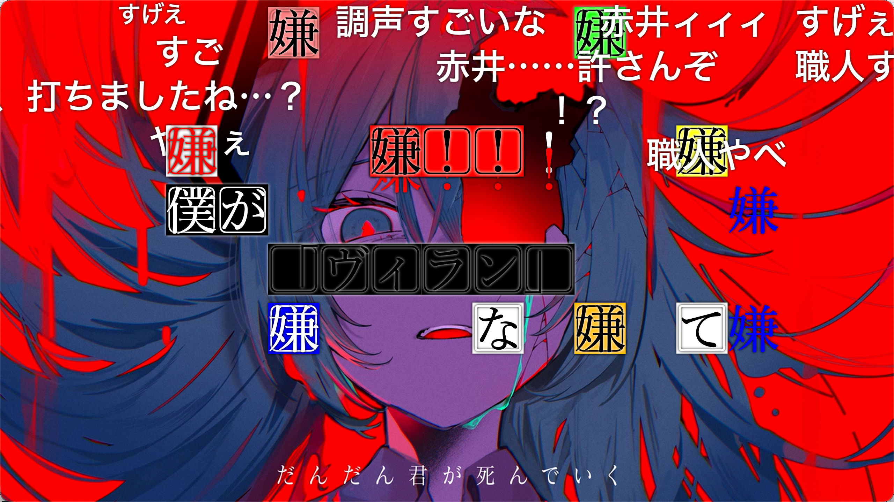
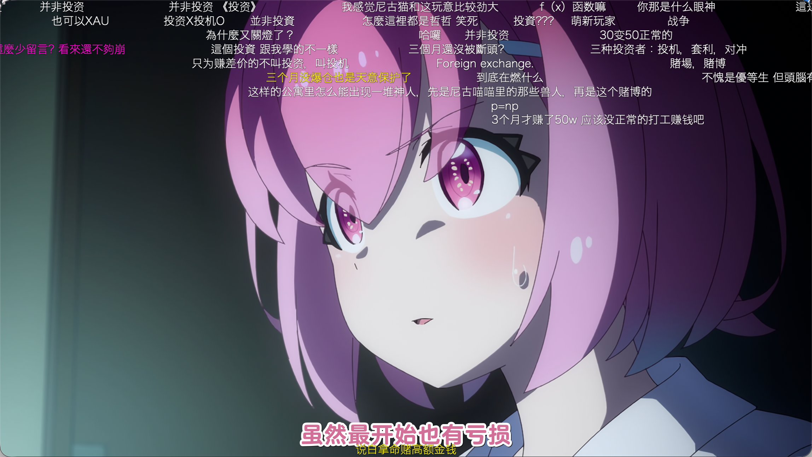
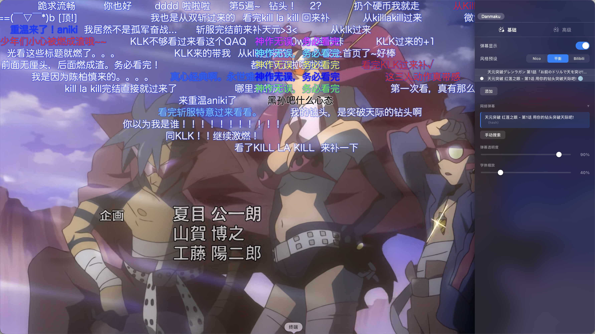

# Danmaku Cosmos

[中文](#中文) / [日本語](#日本語) / [English](#english)

---

## 中文

在 IINA 里看视频时显示弹幕:支持 Niconico / Bilibili 本地弹幕文件,也能自动匹配弹弹play 网络弹幕。

### 安装

1. 安装 [IINA](https://iina.io/)
2. 从 [Releases](https://github.com/karappo-yu/iina-plugin-danmaku-cosmos/releases) 下载 `.iinaplgz`
3. IINA → 设置 → 插件 → 添加插件,选择下载的文件
4. 重启 IINA

### 功能

#### 弹幕来源

- **本地文件自动加载**:打开视频时自动查找同目录下的弹幕文件(同名文件、`弹幕` / `Comments` / `コメント` 文件夹、按集数匹配),也可从侧边栏或菜单手动选择
- **支持格式**:Niconico XML、Niconico V1 / 旧版 JSON、Bilibili XML
- **弹弹play 网络弹幕**:自动为当前视频匹配网络弹幕(文件 hash 精确匹配 → 文件名匹配 → 手动搜索),结果缓存 24 小时,重复播放无需重新下载;可切换网络优先或本地优先

#### 弹幕风格

- **风格预设一键切换**:
  - **Nico**:原生大字、原速、柔和字形阴影
  - **平衡**:Nico 外观,字号和速度减半
  - **Bilibili**:小字、慢速、细体、半透明
- **自由微调**:字体(日文/中文预设或自定义)、粗细、缩放、透明度、描边、阴影模糊、滚动速度,即调即看
- **双渲染模式**:CSS(默认)与 Canvas 可按需切换
- **完整还原 Niconico 弹幕**:字符画(CA)、owner 弹幕、新旧 Flash / HTML5 样式混排

#### 弹幕管理

- **密度控制**:按每分钟弹幕数上限筛选,弹幕少时原样保留,保留弹幕随剧情起伏的节奏;默认不限制
- **日期切片**(Nico JSON):按投稿日期范围筛选,只看某段时间的弹幕
- **屏蔽**:屏蔽词列表(支持正则)、顶部 / 底部固定弹幕独立屏蔽
- **去重合并**:时间窗内的重复弹幕合并为「原文 xN」,后缀独立着色
- **时间轴列表**:流畅浏览数万条弹幕,跟随播放位置滚动,点击时间戳跳转;弹幕文本里的时间(如「空降 01:39」)也可点击跳转

#### 播放辅助

- **弹幕时间偏移**:侧边栏输入秒数,或按 A / D 键快速微调
- **自动片头偏移**:检测弹幕源与视频的时长差异,自动跳过片头(仅 Niconico V1 JSON,默认关闭)
- **繁简转换**:一键将繁体中文弹幕转为简体
- **快捷键**:`Shift + D` 显示 / 隐藏弹幕

### 截图

Nico 风格:

平衡风格:

Bilibili 风格:

自定义风格:

字符画(CA):

---

## 日本語

IINA で動画を見ながらコメントを流せるプラグイン。Niconico / Bilibili のローカルコメントファイルに対応し、弹弹play のネットワークコメントも自動でマッチングします。

### インストール

1. [IINA](https://iina.io/) をインストール
2. [Releases](https://github.com/karappo-yu/iina-plugin-danmaku-cosmos/releases) から `.iinaplgz` をダウンロード
3. IINA → 設定 → プラグイン → プラグインを追加 で、ダウンロードしたファイルを選択
4. IINA を再起動

### 機能

#### コメントソース

- **ローカルファイルの自動読み込み**:動画を開くと、同じフォルダ内のコメントファイルを自動で探します(同名ファイル、`弹幕` / `Comments` / `コメント` フォルダ、話数の自動判別)。サイドバーやメニューから手動で選ぶこともできます
- **対応フォーマット**:Niconico XML、Niconico V1 / 旧版 JSON、Bilibili XML
- **弹弹play ネットワークコメント**:今見ている動画に合うネットワークコメントを自動マッチング(ファイルハッシュによる完全一致 → ファイル名による照合 → 手動検索)。結果は 24 時間キャッシュされるので、見返すときに再ダウンロードは不要です。ネットワーク優先 / ローカル優先を切り替え可能

#### コメントスタイル

- **スタイルプリセットをワンクリックで切り替え**:
  - **Nico**:ニコニコ本来の大きめの文字と速度、柔らかい文字の影
  - **バランス**:Nico と同じ見た目で、文字サイズと速度を半分に
  - **Bilibili**:小さめの文字、ゆっくりした速度、細めのウェイト、半透明
- **自由な微調整**:フォント(和文 / 中文プリセットまたはカスタム)、ウェイト、サイズ倍率、不透明度、縁取り、影のぼかし、スクロール速度。変更はすぐに反映されます
- **2 つの描画モード**:CSS(デフォルト)と Canvas を用途に応じて切り替え
- **ニコニココメントを忠実に再現**:コメントアート(CA)、投稿者コメント、Flash 時代と HTML5 時代のスタイル混在表示に対応

#### コメント管理

- **密度調整**:1 分あたりのコメント数の上限で絞り込みます。コメントが少ない時間帯はそのままなので、物語の展開に応じたコメントの増減が保たれます。デフォルトは無制限
- **投稿日で絞り込み**(Nico JSON):投稿日の範囲を指定して、特定の期間のコメントだけを表示
- **NG 設定**:NG ワードリスト(正規表現対応)、上部 / 下部の固定コメントを個別にブロック
- **重複コメントの集約**:一定時間内の重複コメントを「原文 xN」にまとめ、件数部分は別色で表示
- **タイムライン一覧**:数万件のコメントもスムーズに表示。再生位置に追従してスクロールし、タイムスタンプをクリックするとその位置にシーク。コメント本文の時刻表記もクリックでシークできます

#### 再生サポート

- **コメントのタイムオフセット**:サイドバーで秒数を入力、または A / D キーで手早く微調整
- **OP オフセットの自動設定**:コメントソースと動画の再生時間の差を検出し、オープニングを自動でスキップ(Niconico V1 JSON のみ、デフォルトはオフ)
- **繁体字→簡体字変換**:繁体字の中国語コメントをワンクリックで簡体字に変換
- **ショートカット**:`Shift + D` でコメントの表示 / 非表示を切り替え

### スクリーンショット

Nico スタイル:

バランススタイル:

Bilibili スタイル:

カスタムスタイル:

コメントアート(CA):

---

## English

Display danmaku comments while watching videos in IINA: supports Niconico / Bilibili local comment files, and can automatically match Dandanplay network danmaku.

### Installation

1. Install [IINA](https://iina.io/)
2. Download the `.iinaplgz` file from [Releases](https://github.com/karappo-yu/iina-plugin-danmaku-cosmos/releases)
3. IINA → Settings → Plugins → Add Plugin, then choose the downloaded file
4. Restart IINA

### Features

#### Danmaku Sources

- **Auto-load local files**: when you open a video, the plugin automatically looks for danmaku files in the same folder (same-name file, `弹幕` / `Comments` / `コメント` folders, episode-number matching). You can also pick a file manually from the sidebar or menu
- **Supported formats**: Niconico XML, Niconico V1 / legacy JSON, Bilibili XML
- **Dandanplay network danmaku**: automatically matches network danmaku for the current video (exact file-hash match → filename match → manual search). Results are cached for 24 hours, so replays skip re-downloading. Switchable between network-first and local-first

#### Danmaku Style

- **One-click style presets**:
  - **Nico**: native large font, original speed, soft glyph shadows
  - **Balanced**: the Nico look at half font size and speed
  - **Bilibili**: small font, slow speed, thin weight, semi-transparent
- **Fine-tune freely**: font (Japanese/Chinese presets or custom), weight, scale, opacity, stroke, shadow blur, scroll speed — changes apply instantly
- **Dual render modes**: switch between CSS (default) and Canvas as needed
- **Faithful Niconico reproduction**: comment art (CA), owner comments, and mixed Flash / HTML5 era styles

#### Danmaku Management

- **Density control**: cap the number of comments per minute. Quiet moments stay untouched, preserving the natural ebb and flow of comments as the story unfolds. Unlimited by default
- **Date slicing** (Nico JSON): filter by posting date range to show only comments from a chosen period
- **Blocking**: block-word list (regex supported), plus independent blocking of top / bottom fixed comments
- **Dedupe merge**: repeated comments within a time window merge into "text xN", with the count shown in its own color
- **Timeline list**: smoothly browse tens of thousands of comments; follows the playback position, click a timestamp to seek. Times written inside comment text are clickable too

#### Playback Aids

- **Danmaku time offset**: enter seconds in the sidebar, or tap A / D to nudge quickly
- **Auto intro offset**: detects duration differences between the comment source and the video, and skips the intro automatically (Niconico V1 JSON only, off by default)
- **Traditional → Simplified**: convert Traditional Chinese danmaku to Simplified with one click
- **Shortcut**: `Shift + D` to show / hide danmaku

### Screenshots

Nico style:

Balanced style:

Bilibili style:

Custom style:

Comment art (CA):

---

## License

MIT License. Based on [niconicomments](https://github.com/xpadev-net/niconicomments) (MIT) and [opencc-js](https://github.com/nk2028/opencc-js) (MIT).
