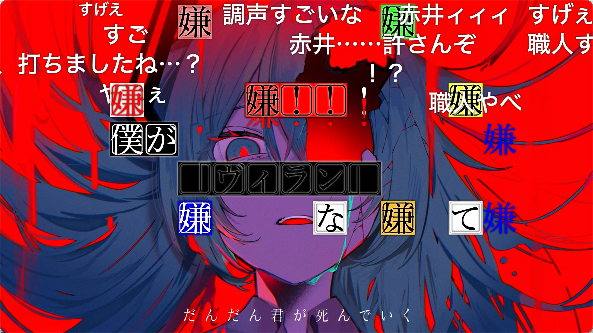
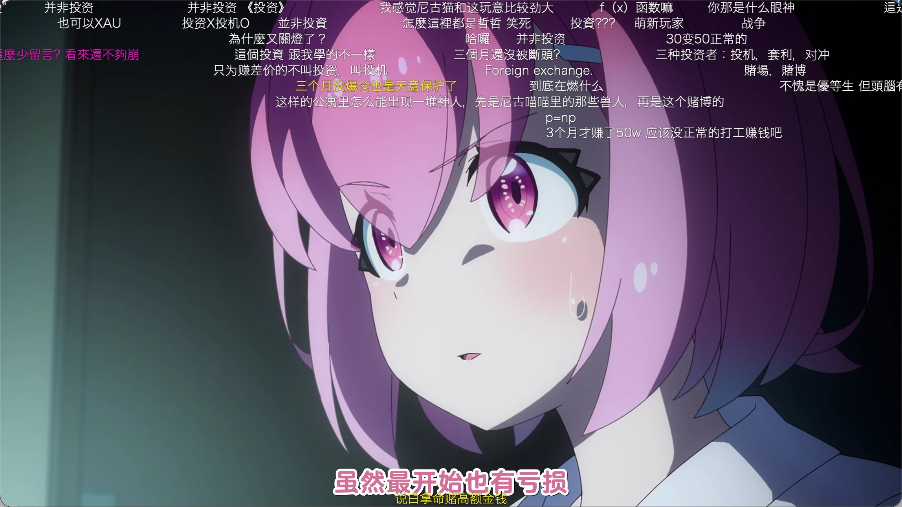

# Danmaku Cosmos

[中文](#中文) · [日本語](#日本語) · [English](#english) · [Screenshots](#screenshots)

---

## 中文

在 IINA 播放视频时叠加显示弹幕：支持 Niconico / Bilibili 本地弹幕文件，并可通过弹弹play 自动匹配网络弹幕。

### 安装

1. 安装 [IINA](https://iina.io/)（需支持插件的 1.4+ 版本，并在 **IINA → 设置 → 插件** 中开启插件支持）
2. 从 [Releases](https://github.com/karappo-yu/iina-plugin-danmaku-cosmos/releases) 下载最新的 `.iinaplgz` 安装包
3. 打开 **IINA → 设置 → 插件 → 从本地安装包安装…**（或「添加插件」），选择下载的文件
4. 重启 IINA

### 功能

#### 弹幕来源

- **本地文件自动加载**：打开视频时自动查找同目录下的弹幕文件（同名文件、`弹幕` / `Comments` / `コメント` 子文件夹、按集数匹配），也可通过侧边栏或菜单手动选择
- **支持格式**：Niconico XML、Niconico V1 / 旧版 JSON、Bilibili XML
- **弹弹play 网络弹幕**：为当前视频匹配网络弹幕（文件 hash 精确匹配 → 文件名匹配 → 手动搜索）；24 小时内重播直接使用缓存、不重新请求；过期缓存不会删除，网络失败时作为备用（标记「(旧)」）；支持切换网络优先或本地优先
  - 自动匹配默认关闭，可在侧边栏开启「自动加载网络弹幕」；关闭时仍可点「网络匹配」或「手动搜索」按需获取
  - 匹配时会向 api.dandanplay.net 发送视频文件名、文件前 16 MB 的 MD5 和文件大小
  - 缓存目录：`~/Library/Application Support/com.colliderli.iina/plugins/.data/com.danmaku-cosmos.iina-plugin/danmaku-cache`

#### 弹幕风格

- **风格预设一键切换**：
  - **Nico**：原生大字、原速、柔和文字阴影
  - **平衡**：Nico 外观，字号和速度减半
  - **Bilibili**：小字、慢速、细体、半透明描边
- **精细自定义**：字体（日文 / 中文预设或自定义）、字重、缩放、透明度、描边、阴影模糊、滚动速度，实时生效
- **双渲染模式**：CSS（默认）与 Canvas 可按需切换
- **忠实还原 Niconico 弹幕**：字符画（CA）、投稿者弹幕（owner）、新旧 Flash / HTML5 样式混排

#### 弹幕管理

- **密度控制**：按每分钟弹幕数上限筛选；弹幕稀疏时段保持原样，保留弹幕随剧情起伏的节奏（默认无限制）
- **日期切片**：按投稿日期范围筛选弹幕（支持 Niconico XML / JSON 及带时间戳的 Bilibili XML）
- **屏蔽过滤**：屏蔽词列表（支持正则表达式）、顶部 / 底部固定弹幕独立屏蔽
  - 正则采用保守检查：`.*`、`.+` 等可变通配符需要在所在分支用 `^` 锚定；被拒绝的规则按普通文字匹配并标记提示
- **去重合并**：时间窗内的重复滚动弹幕合并为 `原文xN`，计数后缀独立着色；重复的顶部 / 底部固定弹幕在屏上接续显示，计数随到达渐进增长（`x2` → `x3`）
- **时间轴列表**：虚拟滚动流畅浏览数万条弹幕，跟随播放进度滚动，点击时间戳跳转；弹幕文本中的时间（如「空降 01:39」）也可点击跳转

#### 播放与同步

- **弹幕时间偏移**：在侧边栏输入秒数，或在侧边栏聚焦时按 `A` / `D` 键以 0.5 秒步进微调
- **自动片头偏移**：检测弹幕源与视频的时长差，自动调整弹幕时间偏移以对齐正片（仅 Niconico V1 JSON，默认关闭）
- **繁简转换**：将 Bilibili 和弹弹play 的繁体中文弹幕转为简体中文；Niconico JSON/XML 保留原文，加载时隐藏此开关
- **快捷键**：`Shift + D` 切换显示 / 隐藏弹幕

---

## 日本語

IINA で動画を見ながらコメントを流せるプラグインです。Niconico / Bilibili のローカルコメントファイルに対応し、DanDanPlay からのオンラインコメント自動マッチングにも対応しています。

### インストール

1. [IINA](https://iina.io/)（プラグイン対応の 1.4 以降）をインストールし、**IINA → 設定 → プラグイン** でプラグイン機能を有効にします
2. [Releases](https://github.com/karappo-yu/iina-plugin-danmaku-cosmos/releases) から最新の `.iinaplgz` をダウンロードします
3. **IINA → 設定 → プラグイン → ローカルパッケージからインストール…**（または「プラグインを追加」）で、ダウンロードしたファイルを選択します
4. IINA を再起動します

### 機能

#### コメントソース

- **ローカルファイルの自動読み込み**：動画を開くと、同じフォルダ内のコメントファイルを自動で検出します（同名ファイル、`弹幕` / `Comments` / `コメント` フォルダ、ファイル名の話数番号による自動一致）。サイドバーやメニューから手動で選ぶこともできます
- **対応フォーマット**：Niconico XML、Niconico V1 / 旧版 JSON、Bilibili XML
- **DanDanPlay オンラインコメント**：再生中の動画に合うオンラインコメントをマッチングします（ファイルハッシュによる完全一致 → ファイル名による候補照合 → 手動検索）。24 時間以内の再生はキャッシュを使い、再リクエストしません。期限切れのキャッシュは削除されず、通信失敗時の予備として使われます（「(旧)」表示）。オンライン優先 / ローカル優先の切り替えにも対応しています
  - 自動マッチングは既定でオフです。サイドバーの「ネットワークコメントを自動読み込み」でオンにできます。オフのままでも「ネットマッチ」や「検索」で必要なときに取得できます
  - マッチング時には、動画のファイル名・先頭 16 MB の MD5・ファイルサイズを api.dandanplay.net に送信します
  - キャッシュの保存先：`~/Library/Application Support/com.colliderli.iina/plugins/.data/com.danmaku-cosmos.iina-plugin/danmaku-cache`

#### コメントスタイル

- **スタイルプリセットをワンクリックで切り替え**：
  - **Nico**：ニコニコ本来の大きめの文字と速度、柔らかい文字の影
  - **バランス**：Nico の見た目のまま、文字サイズと速度を半分に調整
  - **Bilibili**：小さめの文字、ゆっくりした速度、細めのウェイト、半透明の縁取り
- **細かなカスタマイズ**：フォント（日本語 / 中国語プリセット・カスタム指定）、太さ（ウェイト）、サイズ倍率、不透明度、縁取り、影のぼかし、スクロール速度をリアルタイムに調整できます
- **2 つの描画モード**：CSS（デフォルト）と Canvas を用途に応じて切り替えられます
- **ニコニココメントを忠実に再現**：コメントアート（CA）、投稿者コメント、Flash 時代と HTML5 時代のスタイル混在表示に対応しています

#### コメント管理

- **密度調整**：1 分あたりのコメント数に上限を設けて絞り込みます。コメントが少ない時間帯はそのまま残るため、展開に応じた自然な盛り上がりが保たれます（デフォルトは無制限）
- **投稿日で絞り込み**：投稿日の範囲を指定して、特定の期間のコメントだけを表示します（Niconico XML / JSON、およびタイムスタンプ付きの Bilibili XML に対応）
- **NG 設定**：NG ワードリスト（正規表現対応）と、上部 / 下部の固定コメントの個別ブロックに対応しています
  - 正規表現は保守的に検査します。`.*` や `.+` などの可変ワイルドカードには分岐ごとに `^` が必要です。拒否されたルールは通常の文字列として照合し、一覧に表示します
- **重複コメントの集約**：一定時間内の重複スクロールコメントを `本文xN` にまとめ、件数部分を別色で表示します。上部 / 下部の固定コメントは表示中に到着した分だけ件数が増えていきます（`x2` → `x3`）
- **タイムライン一覧**：数万件のコメントも仮想スクロールで軽快に閲覧できます。再生位置に追従してスクロールし、タイムスタンプやコメント本文内の時刻表記（例：`01:39`）をクリックするとその位置にシークします

#### 再生・同期サポート

- **表示タイミング調整（オフセット）**：サイドバーで秒数を指定できるほか、サイドバーにフォーカスがある状態で `A` / `D` キーを押すと 0.5 秒単位で微調整できます
- **尺差によるオフセット自動補正**：コメントソースと動画の再生時間の差を検出し、OP などの尺差に合わせてコメントの表示オフセットを自動調整します（Niconico V1 JSON のみ、デフォルトはオフ）
- **繁体字→簡体字変換**：Bilibili と DanDanPlay の繁体字コメントを簡体字に変換します。Niconico JSON/XML は原文を保持し、読み込み時はこのスイッチを非表示にします
- **ショートカット**：`Shift + D` でコメントの表示 / 非表示を切り替えます

---

## English

An IINA plugin for overlaying danmaku (bullet comments) on videos. Supports local Niconico and Bilibili comment files, plus automatic online comment matching via DanDanPlay.

### Installation

1. Install [IINA](https://iina.io/) (v1.4+ with plugin support enabled in **IINA → Settings → Plugins**).
2. Download the latest `.iinaplgz` package from [Releases](https://github.com/karappo-yu/iina-plugin-danmaku-cosmos/releases).
3. Go to **IINA → Settings → Plugins → Install from a local package…** (or **Add Plugin**) and select the downloaded file.
4. Restart IINA.

### Features

#### Danmaku Sources

- **Auto-load local files**: Automatically looks for local comment files alongside the video (matching filenames, `弹幕` / `Comments` / `コメント` subfolders, and episode-number matching). Files can also be loaded manually from the sidebar or menu.
- **Supported formats**: Niconico XML, Niconico V1 / legacy JSON, and Bilibili XML.
- **DanDanPlay online danmaku**: Matches online comments for the current video (exact file-hash match → filename match → manual search). Replays within 24 hours use the cache without a new request; expired entries are kept (not deleted) and used as a fallback, marked "(old)", when the network fails. Supports online-first and local-first priority modes.
  - Automatic matching is off by default; turn on "Auto-load network danmaku" in the sidebar to enable it. With it off, "Network Match" and "Search" still fetch comments on demand.
  - Matching sends the video's file name, the MD5 of its first 16 MB and its file size to api.dandanplay.net.
  - Cache folder: `~/Library/Application Support/com.colliderli.iina/plugins/.data/com.danmaku-cosmos.iina-plugin/danmaku-cache`

#### Danmaku Style

- **One-click style presets**:
  - **Nico**: Native large font, original scroll speed, soft text shadows.
  - **Balanced**: Nico styling at half the font size and scroll speed.
  - **Bilibili**: Small font, slow scroll speed, thin weight, semi-transparent outline.
- **Fine-grained customization**: Adjust font family (Japanese / Chinese presets or custom), weight, font scale, opacity, outline, shadow blur, and scroll speed with live updates.
- **Dual render modes**: Switch between CSS (default) and Canvas rendering as needed.
- **Authentic Niconico rendering**: Supports Comment Art (CA), owner comments, and mixed Flash / HTML5 era styles.

#### Danmaku Management

- **Density control**: Cap the maximum number of comments per minute while leaving quieter scenes untouched, preserving the natural ebb and flow of reactions (unlimited by default).
- **Date slicing**: Filter comments by posting date range to view reactions from a specific period (supports Niconico XML / JSON and timestamped Bilibili XML).
- **Filtering & blocking**: Keyword blocklist with regex support, plus independent toggles to hide pinned top and bottom comments.
  - Regex screening is conservative: variable wildcards such as `.*` and `.+` require a `^` anchor on their alternative. Rejected rules are matched as plain text and marked in the list.
- **Duplicate merging**: Collapses repeated scrolling comments within a configurable time window into `textxN` with a color-coded count suffix; duplicate pinned top/bottom comments stack in place on screen, incrementing the counter as they arrive (`x2` → `x3`).
- **Timeline list**: Smoothly browse tens of thousands of comments via virtual scrolling. Follows playback position, and both row timestamps and timestamps mentioned inside comments (e.g., `01:39`) are clickable to seek.

#### Playback & Sync

- **Danmaku time offset**: Enter an offset in seconds in the sidebar, or press `A` / `D` (while the sidebar is focused) to nudge by 0.5s increments.
- **Auto timing offset**: Detects duration differences between the comment source and the video and automatically adjusts the comment time offset to align with the intro (Niconico V1 JSON only, off by default).
- **Traditional to Simplified Chinese**: Convert Bilibili and DanDanPlay comments to Simplified Chinese. Niconico JSON/XML retain their original text, and this switch is hidden when they are loaded.
- **Shortcut**: Press `Shift + D` to toggle danmaku visibility.

---

## Screenshots

### Nico Style

### Balanced Style

### Bilibili Style

### Comment Art (CA)

---

## License

[MIT License](LICENSE). Based on [niconicomments](https://github.com/xpadev-net/niconicomments) (MIT, forked as [niconicomments-dom](https://github.com/karappo-yu/niconicomments-dom)) and [opencc-js](https://github.com/nk2028/opencc-js) (MIT).
